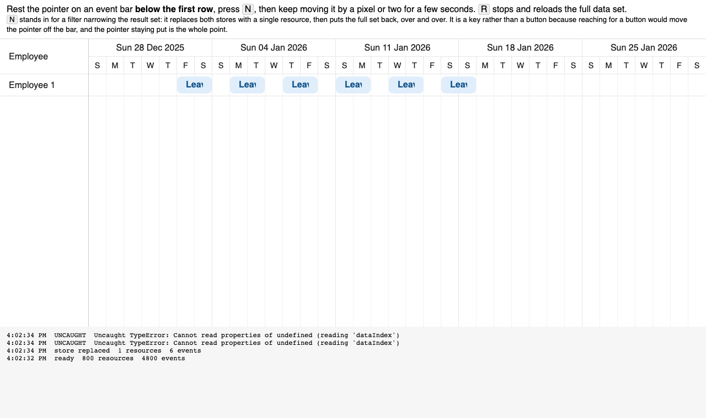

# Hovering an event bar while the stores are replaced throws in `getCellElementFromDomEvent`

Minimal repro for a question on the Bryntum forum. Scheduler Pro 7.3.7, plain JS + Vite.

## Run

```sh
npm install   # needs access to npm.bryntum.com (licensed or trial account)
npm run dev
```

Open the URL Vite prints.

## Steps

1. Rest the pointer on an event bar **below the first row**. The first row survives the narrowing, so a bar sitting on it still resolves to a rendered row and nothing throws.
2. Press **N**. It stands in for a filter narrowing the result set: both stores are swapped between the full data set and a single resource every 900ms for ten seconds. It is a key rather than a button because reaching for a button would move the pointer off the bar, and the pointer staying put is the whole point.
3. Keep moving the pointer by a pixel or two while that runs.

It throws, and keeps throwing on every further pointer move until the redraw settles:

```
TypeError: Cannot read properties of undefined (reading 'dataIndex')
    at SchedulerPro.getCellElementFromDomEvent
    at SchedulerPro.getTimelineEventContext
    at SchedulerPro.handleScheduleEvent
```



A single swap leaves the inconsistent state observable for about 300ms, which is awkward to land a pointer move in on the first try — hence the repeated swaps. There is also a script that does the three gestures on its own:

```sh
npm run dev     # in one terminal
npm run repro   # in another
```

It reproduces on every run here.

## Why the data set is this large

The failure needs the redraw to take longer than one frame. With 60 resources it is over within a single frame, the stores and the rendered rows are never observably out of step, and nothing throws. We measured the window by scanning every frame after the store swap:

| resources × events per resource | frames with the inconsistent state |
| ------------------------------- | ---------------------------------- |
| 60 × 1                          | 0                                  |
| 300 × 3                         | 0                                  |
| 800 × 6                         | 19 (~300ms)                        |

## What we think happens

`getCellElementFromDomEvent` resolves the record behind a hovered bar through two lookups, and assumes at least one of them answers:

```js
if (eventElement) {
    return me.getCell({
        record : me.resolveRowRecord(eventElement) || me.store.getAt(me.rowManager.getRowAt(clientY, false).dataIndex),
        column : me.timeAxisColumn
    });
}
```

During the redraw both miss:

- `resolveRowRecord(eventElement)` reads `data-resource-id` off the bar and looks it up in the resource store. The bar is still painted for a resource the store no longer holds, so this returns `undefined`.
- `rowManager.getRowAt(clientY, false)` only searches rendered rows. Those are already rebuilt down to one, so a pointer any further down matches nothing — and `.dataIndex` is read off `undefined`.

The event bars live in `.b-sch-foreground-canvas`, a sibling of the rows rather than a child, so the rows and the bars are torn down by separate paths and can be out of step for a few frames.

The branch five lines below guards the same call:

```js
if (foregroundCanvas.contains(target)) {
    if (target === foregroundCanvas || target.closest('.b-sch-resource-time-range') || type === 'mousemove') {
        return me.rowManager.getRowAt(clientY, false)?.getCell(me.timeAxisColumn.id);
    }
}
```

Checked on 7.3.5 and 7.3.7: the three functions on this path are byte-identical, so this is not a recent change.

## Why it matters to us

In our app this is a leave calendar. A user picks a value in a filter dropdown that overlays the schedule, the result set drops from a handful of rows to one, and the pointer is simply left where the dropdown option was — over a bar that is briefly stale. Nothing is clicked. It is one of our most frequent production errors, and because it is thrown from a DOM listener it reaches no Bryntum listener we could handle it in.
